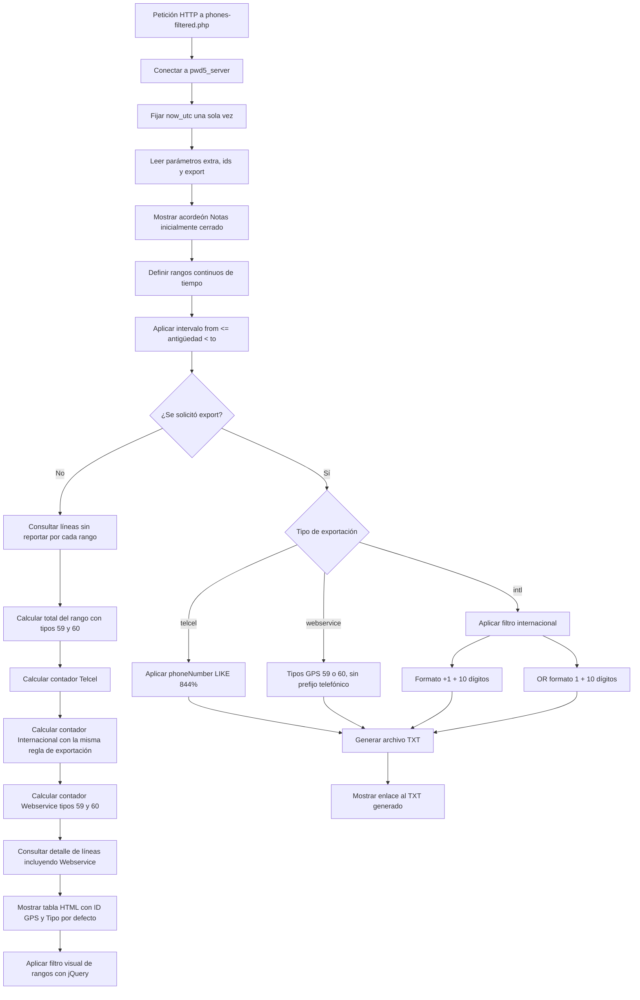

# Diagrama funcional — phones-filtered v1.13



## Rangos de tiempo de la versión 1.13

```text
[10, 60)
[60, 120)
[120, 180)
[180, 240)
[240, 300)
[300, 360)
[360, 1440)
```

La versión 1.10 fija una sola referencia UTC al inicio:

```php
$now_utc = gmdate('Y-m-d H:i:s');
```

En SQL los rangos se implementan usando siempre ese mismo timestamp:

```sql
reportDate <= ADDDATE('$now_utc', INTERVAL -$from MINUTE)
AND reportDate > ADDDATE('$now_utc', INTERVAL -$to MINUTE)
```

Esto hace que cada frontera pertenezca a un solo rango, que no existan huecos y que un registro no pueda cambiar de periodo durante la misma ejecución por el paso del tiempo entre consultas.

## Regla internacional

```sql
(
	phoneNumber REGEXP '^[+]1[0-9]{10}$'
	OR phoneNumber REGEXP '^1[0-9]{10}$'
)
```

La condición es un `OR`: basta con que el número cumpla uno de los dos formatos.

## Exportación Webservice

El parámetro `?export=webservice` crea `phone-filtered-webservice.txt`. Tanto el conteo como la exportación aplican `i.idgpstype IN (59,60)` y conservan los filtros comunes, el instante fijo `$now_utc` y los rangos de tiempo. Los botones Telcel e Internacional conservan la exclusión de tipos anterior.

## Notas informativas (desde v1.12)

Debajo de la hora, el acordeón **Notas** está contraído al cargar la página. Al desplegarlo aparecen los mismos tres avisos de Helpdesk Telcel y PDPs, sin alterar sus textos. Se conserva la lógica anterior de exportación y filtrado.

## Bloques de visualización (v1.13)

- Conteo global y consulta de la tabla: `i.idgpstype NOT IN (82,78,105,106)`; incluye 59 y 60.
- Conteo Telcel: `phoneNumber LIKE '844%'` y `i.idgpstype NOT IN (59,60,82,78,105,106)`.
- Conteo Internacional: formatos `+1XXXXXXXXXX` o `1XXXXXXXXXX` y exclusión `(59,60,82,78,105,106)`.
- Conteo Webservice: `i.idgpstype IN (59,60)`, sin filtro de prefijo telefónico.
- Columnas por defecto: ID GPS, Teléfono, Último reporte y Tipo.
- Acordeón Notas conserva el borde `border-primary`, Bootstrap Icons y el estado inicial cerrado.
